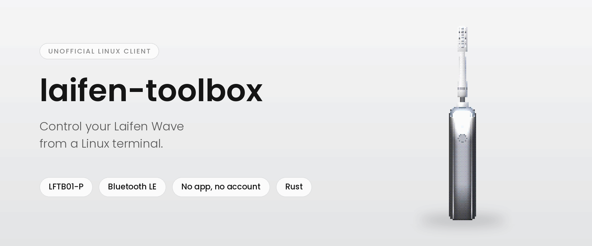
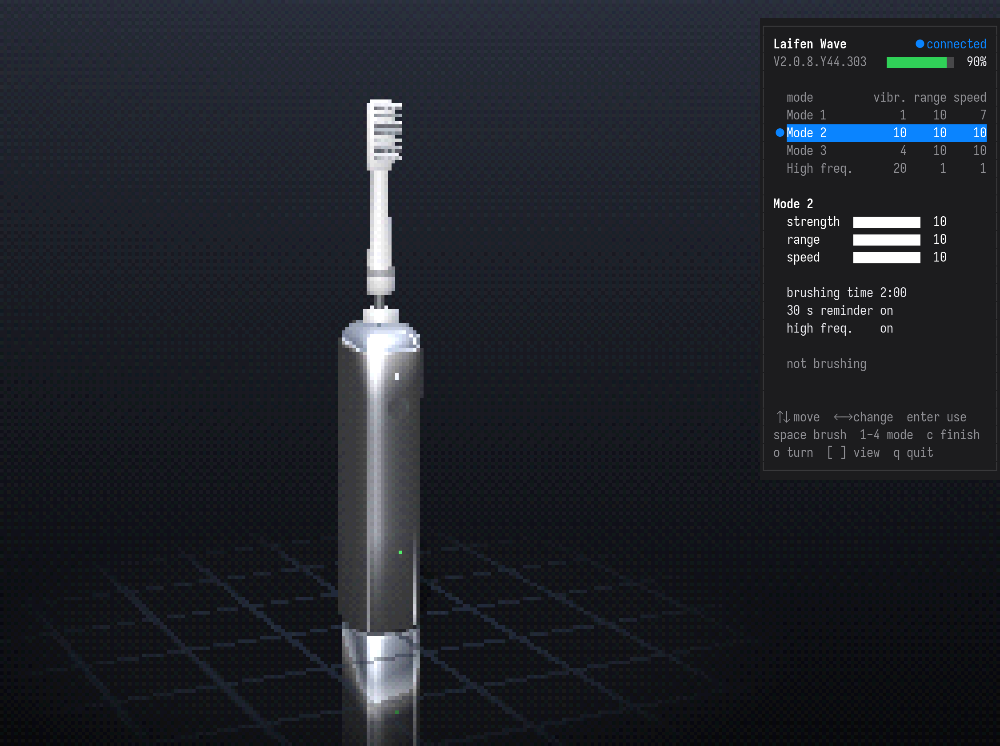
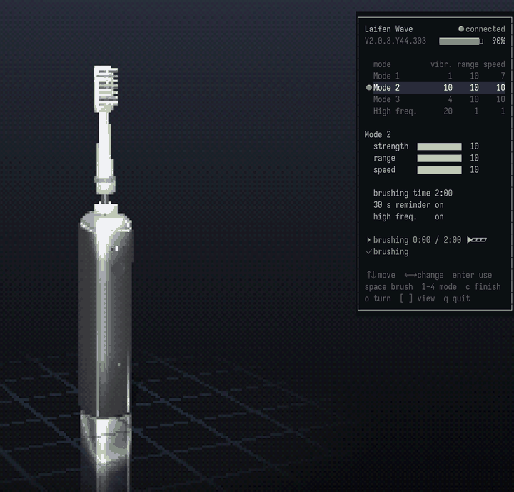
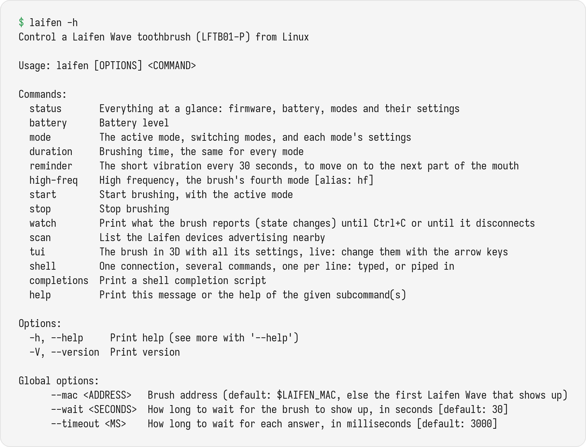
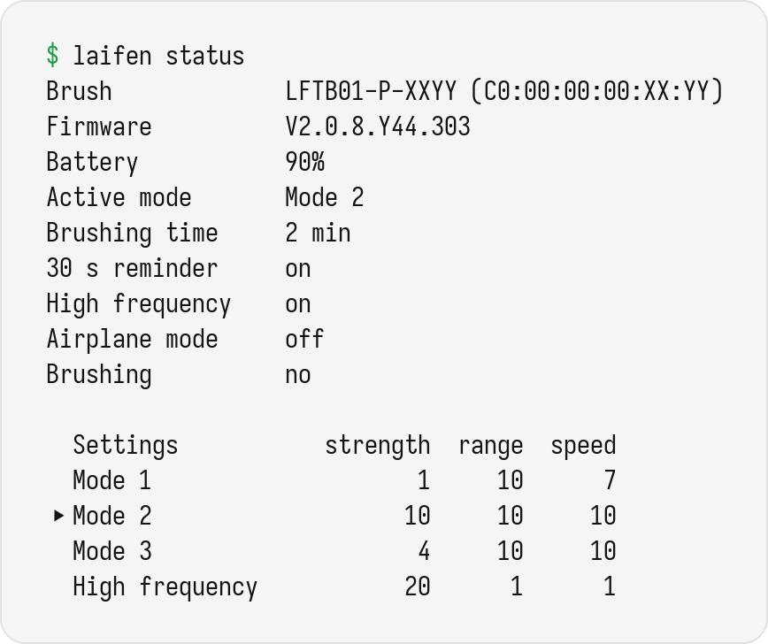
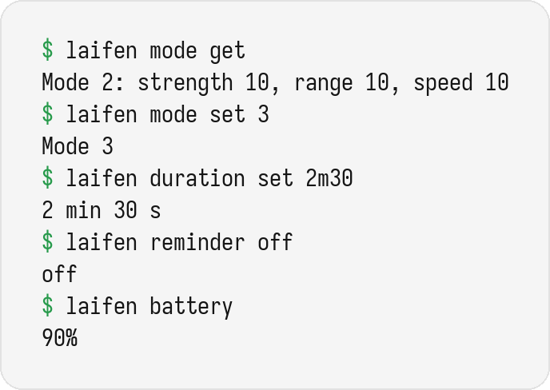

<p align="center">
  <picture>
    <source media="(prefers-color-scheme: dark)" srcset="docs/images/hero-dark.png">
    
  </picture>
</p>

<p align="center">
  <a href="https://github.com/marc-alexis-com/laifen-toolbox/actions/workflows/ci.yml"></a>
  <a href="LICENSE"></a>
  
  
</p>

**`laifen`** is a single command-line tool that controls the **Laifen Wave** electric toothbrush
from Linux over Bluetooth LE: its four modes and their settings, brushing time, 30-second
reminder, high frequency, battery, starting and stopping, and a live 3D view of the brush in
the terminal. No phone, no app, no account.

> [!IMPORTANT]
> Only the **Laifen Wave** (model `LFTB01-P`, firmware `V2.0.8.Y44.303`) has been tested. Laifen's
> other brushes speak a different protocol and are **not supported**: `laifen` refuses to talk
> to them.

## Features

| Area | What you get |
|---|---|
| **Status** | battery, active mode, every mode's settings, brushing time, reminder, high frequency, airplane mode, brushing or not: one command, or JSON |
| **Modes** | switch among Mode 1, 2, 3 and high frequency; set each mode's vibration strength, oscillation range and oscillation speed, on the vendor app's scales |
| **Brushing** | brushing time (1 to 5 minutes, in 30-second steps), the 30-second reminder, high frequency on or off; start and stop the motor from the computer |
| **3D view** | `laifen tui`: a low-poly Laifen Wave in polished steel, turning on a mirror floor; every setting at hand on the arrow keys; while it brushes, its head swings with the mode's range and speed, and a timer counts the 30-second steps. A real picture in kitty (tmux included), text blocks elsewhere |
| **One wake, many commands** | the brush falls asleep soon after a disconnection: `laifen shell` runs several commands over one connection, typed or piped in |
| **Events** | `laifen watch` prints what the brush reports on its own |
| **Safety** | only commands tested on a real brush can leave the computer; factory reset, calibration, airplane mode, emergency shutdown and firmware updates are not implemented |

## A look at it

<p align="center">
  
  <br><sub><code>laifen tui</code> connected to a Laifen Wave, as kitty shows it. The window holds the four modes, the settings of the one being edited, brushing time, reminder and high frequency.</sub>
</p>

<p align="center">
  
  <br><sub>While the brush runs, its head swings with the active mode's range and speed, slowed down to be seen.</sub>
</p>

<p align="center">
  
  <br><sub>Every command, from <code>laifen -h</code>. Each one has its own <code>--help</code>.</sub>
</p>

<p align="center">
  
  
</p>

## Install

Requirements: Linux with BlueZ. There are no native dependencies: `laifen` speaks to BlueZ over
D-Bus by itself, without a D-Bus library.

**Prebuilt binary** (static, x86_64 or aarch64), from the
[releases page](https://github.com/marc-alexis-com/laifen-toolbox/releases):

```sh
curl -LO https://github.com/marc-alexis-com/laifen-toolbox/releases/latest/download/laifen-v0.1.1-x86_64-unknown-linux-musl.tar.gz
tar xzf laifen-v0.1.1-x86_64-unknown-linux-musl.tar.gz
install -Dm755 laifen-v0.1.1-x86_64-unknown-linux-musl/laifen ~/.local/bin/laifen
```

Each archive also holds shell completions; a `.sha256` file sits next to it.

**Nix** (flake, with completions):

```sh
nix run github:marc-alexis-com/laifen-toolbox -- status
nix profile install github:marc-alexis-com/laifen-toolbox
```

**From source** (a recent stable Rust toolchain):

```sh
cargo install --git https://github.com/marc-alexis-com/laifen-toolbox
```

No pairing is needed. Wake the brush (press its button), close the Laifen app on your phone if
it is open, then:

```sh
laifen status
```

`laifen` finds the brush by its Bluetooth name (`LFTB01-P-…`). `--mac AA:BB:CC:DD:EE:FF` or
`LAIFEN_MAC` pick one brush among several.

## Commands

```sh
laifen status [--json]               # everything at a glance
laifen battery [--json]
laifen mode get | set <1|2|3|hf>
laifen mode tune <1|2|3|hf> [--strength N] [--range N] [--speed N]
laifen duration get | set <DURATION> # 150, 2m30 or 2:30; 1 to 5 minutes in 30-second steps
laifen reminder get | on | off       # the short vibration every 30 seconds
laifen high-freq get | on | off      # the fourth mode
laifen start | stop                  # brush with the active mode
laifen tui [--demo] [--finish steel|aluminium|white] [--blocks]
laifen shell                         # one connection, one command per line
laifen watch [--raw]                 # what the brush reports, until Ctrl+C
laifen scan [--seconds N]            # Laifen devices nearby
```

Strength runs from 1 to 10 (11 to 20 for high frequency), range and speed from 1 to 10, as in the
vendor app. `mode tune` changes a mode without switching to it. Every command has `--help`.

## The brush sleeps

The Laifen Wave only advertises while it is awake, and a brush connected to the phone app is
most likely invisible to everybody else. Each `laifen` command finds the brush, connects, does its
work, reads the result back and disconnects; after that, the brush can take a while to show up
again. On the brush tested, the next command usually found it within 20 seconds; once, it took
two minutes.

So, for several changes, keep one connection:

```sh
printf 'mode set 3\nduration set 2m30\nreminder off\n' | laifen shell
```

`laifen shell` without input gives a prompt. The 3D view also keeps its connection, and connects
again on its own when the brush wakes up.

## The 3D view

```sh
laifen tui
laifen tui --demo        # no brush needed: a simulated one
```

| Key | |
|---|---|
| `↑` `↓` | move between the modes, the three settings, brushing time, reminder, high frequency |
| `←` `→` | change the value under the cursor; on the modes, pick the mode to edit |
| `⏎`, `1`-`4` | switch to that mode |
| `space` | start or stop brushing |
| `c` | finish: polished steel, aluminium, white |
| `o`, `[` `]` | stop or restart the turntable, turn the view |
| `q` | quit; the brush is disconnected |

A change is sent once the keys have been still for half a second, then read back from the brush;
the line under the settings says when it is done. The picture is drawn by the tool's own small
renderer, PS2 style: a low-poly brush, lit per pixel, with a reflected studio on the steel, a
mirror floor and a 15-bit dithered palette. While the brush runs, its head swings with the active
mode's oscillation range and speed and shivers with its vibration strength: the real head moves
far too fast to be drawn, so the motion is slowed down. The mode lights and the battery light are
drawn from the brush's state; they illustrate it, they are not a capture of the real lights.

In kitty the picture is a real image, also through tmux when it lets graphics through
(`set -g allow-passthrough on` in `tmux.conf`). Other terminals get the same picture in text
blocks (`--blocks` forces them).

## Safety

The protocol has commands that reset the brush to factory settings, start a calibration or
rewrite its firmware, and the brush asks for no pairing. `laifen` sorts every command code
before a frame is even built:

| Class | Examples | Policy |
|---|---|---|
| Reads | state, firmware version | always allowed |
| Tested writes | mode, mode settings, brushing time, 30 s reminder, high frequency, start and stop | allowed: each one was written, read back and restored on a real LFTB01-P |
| Not implemented | factory reset, brush-head calibration, setting the date, airplane mode, emergency shutdown, deep clean, restoring a mode's defaults, the brushing history, firmware updates | never sent |

Changes are also refused while the brush reports airplane mode, as the vendor app does. The
firmware-update service the brush exposes is never touched.

## Protocol

[docs/PROTOCOL.md](docs/PROTOCOL.md) describes the wire format and every command used here, each
fact marked as **confirmed** on the device, taken from the vendor app's behaviour, or
**inferred**. The full reverse-engineering notebook, in French, covers the rest of Laifen's range
from the app's code: [laifen-re](https://github.com/marc-alexis-com/laifen-re).

## Tested hardware

| Product | Model | Firmware | Status |
|---|---|---|---|
| Laifen Wave | `LFTB01-P` | `V2.0.8.Y44.303` | tested, see below |
| Other Laifen brushes | `LFTB01-SE`, `LFTB02-S…`, `LFTB01-C`… | | another protocol: not supported |

On the LFTB01-P, with this tool: every setting was changed, read back and restored in one
session; the motor was started and stopped from the computer (its owner felt it run); the state,
the firmware version sent on connection, and the state the brush pushes after a change were all
read. `laifen tui` connected to the brush, changed the brushing time from the keyboard and back,
and started and stopped brushing. Not yet exercised: `watch`, and what the brush reports when its
button is pressed.

## Troubleshooting

| Symptom | Likely cause |
|---|---|
| `no Laifen Wave found` | The brush sleeps: press its button. Or the phone app holds it: close the app. |
| A command waits a few seconds before doing anything | The brush is coming back after the previous command. `laifen shell` keeps one connection. |
| `the Bluetooth adapter … is off` | `bluetoothctl power on`. |
| `the brush is in airplane mode` | The vendor app refuses every change then, and so does `laifen`. |
| `laifen tui` shows text blocks in kitty, inside tmux | tmux does not pass graphics through: `set -g allow-passthrough on`. |

## Development

```sh
nix develop                           # optional: a shell with the Rust toolchain
cargo test                            # frames, decoders, safety policy, D-Bus, the view
cargo clippy --all-targets -- -D warnings
cargo fmt --check
```

The source is small and dependency-light (`clap`, `clap_complete`, `libc`):

| File | Role |
|---|---|
| `src/frame.rs` | frame encoding and decoding, XOR checksum |
| `src/cmd.rs` | command codes and the safety policy |
| `src/decode.rs` | the state, firmware version and refusal codes, tested against real frames |
| `src/dbus.rs` | a minimal D-Bus client: method calls, replies, signals |
| `src/bluez.rs` | BlueZ: discovery, connection, the protocol characteristic |
| `src/brush.rs` | one session with the brush: ask, write, read back |
| `src/tui.rs` | `laifen tui`: the screen, the keys, the Bluetooth thread, the demo brush |
| `src/viz.rs` | the picture in kitty or in text blocks, and its window |
| `src/ps2.rs` | the software renderer: depth buffer, lighting, reflections, mirror floor, dithering |
| `src/wave.rs` | the low-poly Laifen Wave, from its published size and the vendor's product pictures |
| `src/kitty.rs`, `src/zlib.rs` | the kitty graphics protocol and its deflate compressor |
| `src/signals.rs` | clean shutdown on Ctrl+C / SIGTERM |
| `src/main.rs` | the command line, `shell`, `watch`, `scan` |

The renderer, the kitty protocol and the compressor come from
[nothing-toolbox](https://github.com/marc-alexis-com/nothing-toolbox), the same author's tool for
the Nothing Headphone (1).

## Legal

This is an independent interoperability project, built on hardware owned by the author. It is
not affiliated with, endorsed by or supported by Laifen. The repository contains no firmware or
application code from Laifen, only a description of the wire protocol and an original client. The
3D brush of `laifen tui` is an original low-poly model built from the product's published size
and proportions; no picture of the product is included. "Laifen" and "Laifen Wave" are
trademarks of their owner, used here only to name the hardware this tool talks to. The
illustrations are generated by [docs/images/render.py](docs/images/render.py) (fonts: Poppins,
under the SIL Open Font License, and Iosevka) from this tool's real output and its own renderer: the
3D brush in the banner, the screenshot and the animation is the tool's renderer, the window over
it shows the state read from the author's brush, and the brush's address is masked.

Use at your own risk: the safety policy above limits what can be sent, it cannot guarantee what
the brush does with it.

## License

[MIT](LICENSE)
